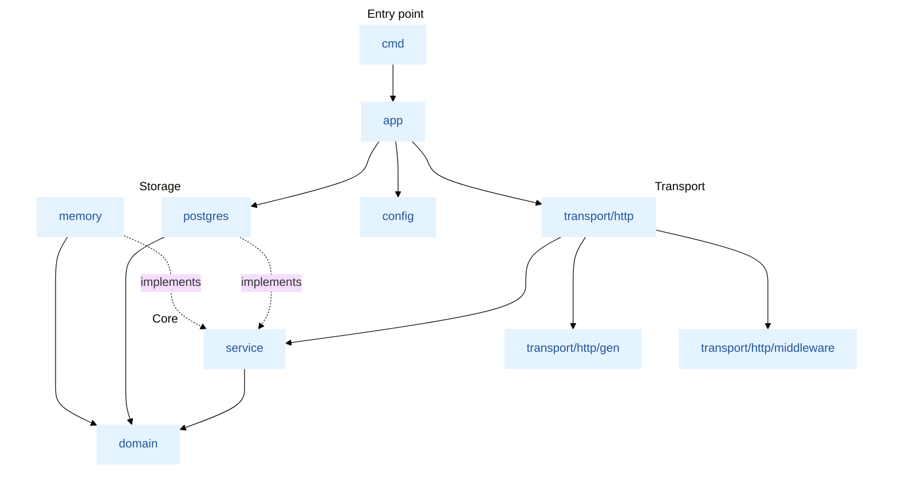
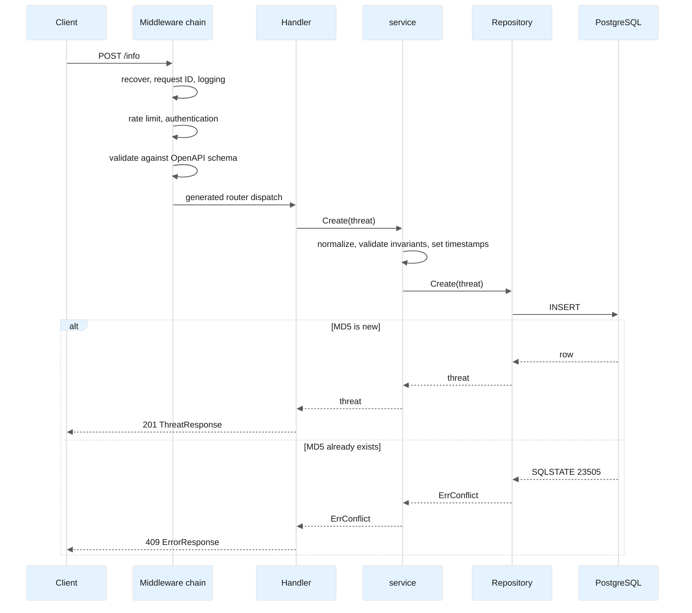
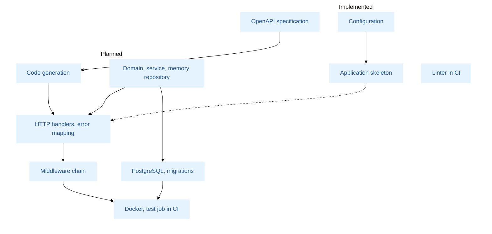

# Architecture

## Overview

Threat Info Service is a REST service that stores and exchanges threat intelligence. A threat is identified by the MD5 hash of the malicious file and carries a name, a severity, a category, an optional description and tags.

The service is organized as a stack of layers with a single rule: **dependencies point inward only**.

- **Contract** — [api/openapi.yaml](api/openapi.yaml) is the single source of truth for the HTTP interface. The server interface and the request/response types are generated from it, and requests are validated against the same schema they are documented with, so the specification and the implementation cannot drift apart.
- **Domain** — the `Threat` model, its enumerations, its invariants, and the typed errors. It imports nothing from the project.
- **Service** — the use cases `Create`, `Get` and `Update`. It depends on the domain and on a small storage interface that it declares itself.
- **Adapters** — the PostgreSQL repository, the in-memory repository used by tests, and the HTTP transport. They depend on the service and the domain, never the other way around.
- **Composition root** — `internal/app` is the only package that knows every other one. It builds the dependencies, owns their lifetime, and wires them together.

The goal is not an "enterprise" structure: each boundary exists because it removes a concrete dependency, and a layer that does not pay for itself is not introduced (see "Non-goals").

Solid arrows are imports. Dashed arrows mark interface implementation: `service` declares the repository interface, and `postgres` and `memory` satisfy it without importing `service`.

## Request lifecycle

The sequence below traces `POST /info`, the request that exercises every layer.

1. The server accepts the connection and passes the request through the **middleware chain**, outermost first: panic recovery, request ID, logging, rate limiting, authentication, and validation against the OpenAPI schema. Authentication applies only to the operations that declare a security requirement in the specification (`POST` and `PUT`).
2. Validation checks what the schema can express: the MD5 pattern, enumerations, length limits, and unknown fields (`additionalProperties: false`). A request that fails is answered `400` in the `ErrorResponse` format.
3. The generated router calls the handler, which converts the request into a domain value and calls the service.
4. The service normalizes the input (the MD5 and the tags are lowercased, strings are trimmed), enforces the business invariants, sets `created_at` and `updated_at` from its clock, and calls the repository.
5. The repository inserts the row. It never reads before it writes: uniqueness is enforced by the primary key, and a violation (SQLSTATE `23505`) is returned as `domain.ErrConflict`.
6. The handler maps the result. A single function in `transport/http/errors.go` translates every domain error into a status code and an `ErrorResponse`, so handlers know nothing about PostgreSQL error codes and the storage layer knows nothing about HTTP.

`GET /info/{md5}` and `PUT /info/{md5}` follow the same path. A missing record is reported as `domain.ErrNotFound` and answered `404`. `PUT` is a single `UPDATE … RETURNING`; zero affected rows means the record does not exist.

## Key design decisions

**Specification first.** The OpenAPI document precedes the code. `oapi-codegen` produces the server interface and the types, and CI verifies that regenerating them leaves the working tree unchanged, so a hand edit of generated code or a forgotten regeneration fails the build. The router is the standard `net/http` mux; no third-party router is needed.

**Validation in two places.** The schema validator, which runs at the edge, owns the format: patterns, enumerations, lengths, unknown fields. The domain owns the invariants that do not depend on transport: the MD5 is stored in lowercase and never changes after creation. Because of this the service is correct without HTTP, and its tests do not need a server.

**Typed domain errors, one mapping.** The domain defines `ErrNotFound`, `ErrConflict` and `ErrValidation`. Everything below the service wraps them; the one function that maps them to HTTP lives in the transport layer. A new error is a new row in that function, not a new branch in every handler.

**Conflicts are decided by the database.** Creation is a bare `INSERT`; a unique violation becomes `ErrConflict`. A "check, then insert" sequence would race between concurrent requests, so it is deliberately absent.

**Time is set by the server.** `created_at` and `updated_at` never come from the client. The service obtains them from a `Clock` interface, so tests are deterministic and the in-memory and PostgreSQL repositories behave identically.

**The repository interface belongs to its consumer.** `service` declares the small interface it needs (`Create`, `GetByMD5`, `Update`). `postgres` and `memory` implement it structurally, and `app` asserts that they do. There is no generic repository.

**Configuration is split by sensitivity.** Non-secret values (listener address, timeouts, pool sizing, log level) are read from a strict YAML file; unknown keys are rejected. Secrets (the database DSN, access tokens) are read only from environment variables, and a `dsn` key in YAML is an error, so a credential cannot be committed by accident. The merged result is validated once, at startup, and the process refuses to start on any error. See [Configuration](#configuration).

**The connection pool is a resource of the composition root.** `app` opens the pool, hands it to the repository, and closes it after the HTTP server has drained. The `postgres` package defines its own `Config` and does not import `config`, so it can be tested on its own. Ping failures surface at startup rather than on the first request.

**Operational endpoints bypass the API chain.** `/healthz` (the process is alive) and `/readyz` (the database answers a ping) are registered ahead of the API middleware, so they are never rate-limited, authenticated, or validated against the schema.

## Process lifecycle

`cmd/main.go` installs a signal context (`SIGINT`, `SIGTERM`) and calls `app.New` followed by `App.Run`.

1. **Construction (`app.New`).** Flags are parsed into a private `FlagSet`. The configuration path is resolved with the precedence flag > environment > default, the YAML file is decoded strictly, secrets are read from the environment, and the result is validated. No network I/O happens at this stage.
2. **Serving (`App.Run`).** Resources with a lifetime are opened and the HTTP server is started. `Run` blocks until the signal context is canceled or a component fails.
3. **Shutdown.** The server stops accepting connections and drains in-flight requests within a bounded timeout. The database pool is closed only after the server has stopped, so nothing uses it while it is closed. A clean, signal-driven shutdown returns `nil`.

## Configuration

| Source | Content | Notes |
|---|---|---|
| `configs/config.yaml` | log level, HTTP listener and timeouts, pool sizing, database timeouts | Strict decoding: unknown keys fail the load |
| `THREAT_INFO_DATABASE_DSN` | database DSN | Required; rejected if present in YAML |
| `THREAT_INFO_CONFIG_PATH` | path to the YAML file | Overridden by the `-config` flag; defaults to `configs/config.yaml` |

Validation rejects non-positive timeouts, a `read_header_timeout` above `read_timeout`, a `min_conns` above `max_conns`, a `max_conn_idle_time` above `max_conn_lifetime`, a `transaction` timeout below the `query` timeout, and an empty or malformed listener address.

## Package layout

| Package | Responsibility |
|---|---|
| `cmd` | Process entry point: signal context, exit code |
| `internal/app` | Composition root: configuration loading, dependency construction, lifecycle, graceful shutdown |
| `internal/config` | Strict YAML decoding, environment secrets, path resolution, validation |
| `internal/domain` | `Threat`, enumerations, invariants, `ErrNotFound`, `ErrConflict`, `ErrValidation` |
| `internal/service` | `ThreatService` use cases, input normalization, the repository interface, the `Clock` interface |
| `internal/postgres` | Connection pool, repository, embedded migrations |
| `internal/memory` | In-memory repository for unit and handler tests |
| `internal/transport/http` | Handlers implementing the generated server interface, error mapping, server construction |
| `internal/transport/http/gen` | Generated code. Never edited by hand |
| `internal/transport/http/middleware` | Recovery, request ID, logging, rate limiting, authentication |
| `api` | The OpenAPI specification |

## Dependency rules

| Layer | May import | Must not import |
|---|---|---|
| `domain` | standard library | every other internal package |
| `service` | `domain` | `postgres`, `memory`, `transport`, `config`, `app` |
| `postgres`, `memory` | `domain`, their own third-party drivers | `service`, `transport`, `config`, `app` |
| `transport/http` | `service`, `domain`, `gen`, `middleware` | `postgres`, `memory`, `app` |
| `config` | standard library, `gopkg.in/yaml.v3` | every other internal package |
| `app` | everything (composition root) | — |

Nothing under `internal/` may import `internal/app`; only `cmd` and tests do. These rules are currently a convention. Enforcing them with the `depguard` linter, as a CI check next to the formatter, is planned once the packages exist.

## Testing strategy

| Level | Scope | Approach |
|---|---|---|
| Unit | `domain`, `service`, `config` | Table-driven tests against the in-memory repository, run with `-race` |
| Fuzz | MD5 validation and normalization | `go test -fuzz` |
| Handler | Status codes, error format, strict JSON | `httptest` over the in-memory repository |
| Integration | The whole chain and the SQL | A real PostgreSQL in a container: uniqueness, concurrent `POST`, migrations |
| Contract | Responses conform to `openapi.yaml` | Response validation against the specification |

## Implementation status

| Area | Status |
|---|---|
| OpenAPI specification | Done |
| Configuration: YAML, environment secrets, validation, tests | Done |
| Application skeleton: construction, signal handling, graceful stop | Done |
| Code generation from the specification | Planned |
| `domain`, `service`, `memory` | Planned |
| HTTP handlers and error mapping | Planned |
| PostgreSQL pool, repository, migrations | Planned |
| Middleware: recovery, request ID, logging, rate limiting, authentication | Planned |
| Health endpoints | Planned |
| Dockerfile, Compose file, continuous-integration test job | Planned |
| Optional TLS | Planned |

The diagram places the planned work against what exists today.

## Non-goals

The following are excluded on purpose, because each adds code to review without serving the task:

- Dependency-injection frameworks, CQRS, an event bus, a generic repository.
- A custom router or a hand-written validator where code generation provides one.
- Business logic in handlers or in SQL.
- `DELETE` and list endpoints: the specification does not define them.
