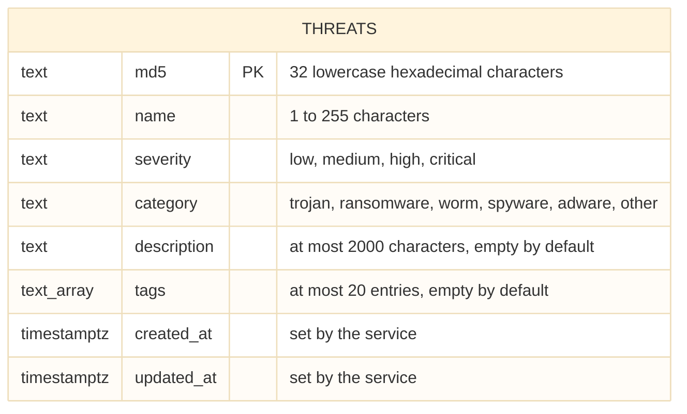

# Database

The service stores threats in PostgreSQL 18. The model has one entity, so the schema is a single table.

## Table `threats`

| Column        | Type          | Constraints                                                                   |
|---------------|---------------|-------------------------------------------------------------------------------|
| `md5`         | `text`        | Primary key; matches `^[0-9a-f]{32}$`                                         |
| `name`        | `text`        | Not null; 1 to 255 characters                                                 |
| `severity`    | `text`        | Not null; one of `low`, `medium`, `high`, `critical`                          |
| `category`    | `text`        | Not null; one of `trojan`, `ransomware`, `worm`, `spyware`, `adware`, `other` |
| `description` | `text`        | Not null; default `''`; at most 2000 characters                               |
| `tags`        | `text[]`      | Not null; default `{}`; at most 20 entries                                    |
| `created_at`  | `timestamptz` | Not null; never changes after the insert                                      |
| `updated_at`  | `timestamptz` | Not null; set on every update                                                 |

## Design decisions

**The MD5 is the primary key.** It identifies a threat and never changes, so a surrogate identifier would add a column and an index without adding meaning. The primary key also decides uniqueness: a second insert of the same hash fails with SQLSTATE `23505`, which the repository reports as a conflict. There is no check before the insert, so concurrent requests cannot both succeed.

**Constraints repeat the domain rules.** The domain validates every value before it reaches the database. The `CHECK` constraints are a second line of defense: no code path, including a manual query, can store an uppercase hash, an unknown severity or an empty name. Per-entry limits of `tags` (non-empty, at most 50 characters) are enforced by the domain only, because a `CHECK` constraint cannot run a subquery.

**Enumerations are `text` with a `CHECK`.** A native `ENUM` type cannot drop a value and needs its own statements to extend. Adding a severity or a category is one migration that replaces a constraint.

**Timestamps come from the service.** The service sets `created_at` and `updated_at` from an injected clock, so tests are deterministic and the timestamps do not depend on the database clock. The columns have no database default for that reason.

**No secondary indexes.** Every query reads or writes a single row by the primary key. An index is added together with the first query that needs one.

## Statements

| Operation | Statement (see `internal/repository`) |
|---|---|
| Create | `INSERT … RETURNING`; a unique violation means the threat exists |
| Get | `SELECT … WHERE md5 = $1` |
| Update | `UPDATE … SET name, severity, category, description, tags, updated_at WHERE md5 = $1 RETURNING`; no returned row means the threat does not exist |

The update never reads before it writes and leaves `md5` and `created_at` untouched.

See [migrations.md](migrations.md) for how the schema is created and changed.
